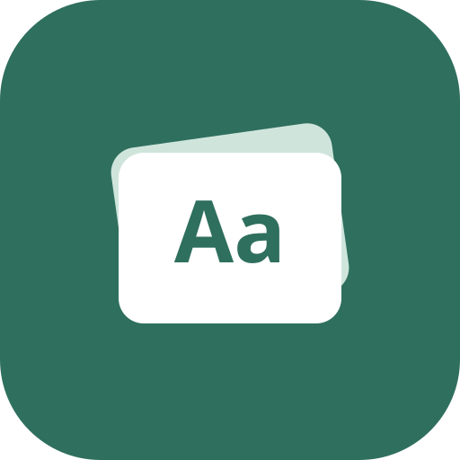

<h1 align="center">Ikna</h1>

<b>Remember anything. The simple alternative to Anki, built for passing exams.</b> 
Flashcards with smart spaced repetition, for exams, facts, definitions, formulas, names or new words.

  <a href="https://william-lindberg.github.io/ikna/"><b>▶ Open the web app</b></a> &nbsp;·&nbsp;
  <a href="https://github.com/William-Lindberg/ikna/releases/latest"><b>⬇ Download for Android (APK)</b></a>

Free · No ads · No tracking · Works offline · Imports your Anki decks

---

## Why Ikna instead of Anki?

Same proven method as Anki, without the confusion, plus the things students need before an exam.
<b>not in Anki</b> = Anki doesn't have it built in. <b>easier than Anki</b> = Anki can do it, but it takes more work.

### ⚡ Adding cards
- [x] Quick add: type `question = answer` and press Enter — <b>easier than Anki</b>
- [x] Paste a whole list and get a card for every line — <b>easier than Anki</b>
- [x] Tap words to hide them for fill-in-the-blank cards, no `{{c1::…}}` syntax — <b>easier than Anki</b>
- [x] AI card maker from your notes or a photo (optional, your own OpenAI or Claude key) — <b>not in Anki</b>
- [x] Duplicate warning while you type — <b>not in Anki</b>
- [x] Card tips that help you write cards that are easier to remember — <b>not in Anki</b>
- [x] Photo cards, add while studying, and Share to Ikna from any Android app

### 🎯 Exams
- [x] Exam planner: how much to study each day so every card comes up before the exam — <b>not in Anki</b>
- [x] Timed exam simulation with a score and a list of mistakes — <b>not in Anki</b>
- [x] Comeback mode: a big backlog after a break is spread over a few days — <b>not in Anki</b>
- [x] Study-time estimate ("about 12 min") and 5, 10 or 20-minute sessions — <b>not in Anki</b>
- [x] Retry my mistakes at the end of a session — <b>not in Anki</b>

### 🧠 Simple to use
- [x] Learn it in minutes: four clear buttons (Forgot · Hard · Got it · Easy) — <b>easier than Anki</b>
- [x] One plain memory setting instead of dozens of options — <b>easier than Anki</b>
- [x] Modern FSRS scheduler on by default (in Anki you have to turn it on) — <b>easier than Anki</b>
- [x] Memory strength per deck ("87% remembered ▲") — <b>not in Anki</b>
- [x] Gentle streak with a rest day each week — <b>not in Anki</b>
- [x] Trouble cards: spots cards you keep forgetting and helps you fix them — <b>easier than Anki</b>

### 📱 Everywhere, for free
- [x] Full app in the browser, not just reviewing — <b>not in Anki</b>
- [x] iPhone through the web app, free (Anki's iPhone app is paid) — <b>easier than Anki</b>
- [x] Android app and free sync with email or Google login
- [x] Works fully without an account, offline after the first visit
- [x] No ads, no tracking

### 🔁 Switching from Anki
- [x] Import your Anki decks (.apkg) with pictures, sound and your review progress
- [x] Export back to Anki at any time
- [x] Hide parts of an image (image occlusion), formulas, images and sound, just like Anki

## Everything else

- **Card types:** basic, both ways, type the answer (forgives small typos), fill in the blank, and
  hide parts of an image.
- **Practice** and **Quiz** modes, undo, skip, suspend, edit while studying, and read aloud.
- **Subdecks, tags, flags** and a fast **search** (`tag:exam is:due -easy`).
- **Share a deck** with a friend as a `.ikna` file, and **print** cards or save them as a PDF.
- Imports **Quizlet**, **Excel**, **Google Sheets** and **CSV**.
- **Progress:** streak, retention, a 30-day forecast and a year-long calendar.
- Daily reminders on Android, dark mode, and offline use after the first visit.

## Install

**Web:** open <https://william-lindberg.github.io/ikna/>. In Chrome or Edge choose *Install app*; on
a phone use *Add to Home screen*. On iPhone, use the web app from Safari.

**Android:** on your phone, open [the latest release](https://github.com/William-Lindberg/ikna/releases/latest),
download `Ikna-x.y.z.apk` and open it. The first time, Android asks you to allow installing apps
from your browser or file manager. To update, install the new version over the old one; your cards stay.

## Is it safe?

- **No ads, no tracking.** Without an account, your cards never leave your device.
- **Few permissions.** The Android app only asks for the camera, photos or microphone when you add a
  picture or sound to a card, and for notifications if you turn on daily reminders.
- **Signed by the author.** Every APK is signed with the same key. Its SHA-256 certificate fingerprint is
  `D3:13:66:1C:AD:50:6B:C7:60:0B:4F:BB:79:4D:55:0A:E2:A9:73:53:A1:E6:42:A5:BD:A8:05:6C:BE:6A:B1:ED`.
  Only install Ikna from this page.
- **Privacy:** see the [privacy page](https://william-lindberg.github.io/ikna/privacy.html).

## License

Ikna is free to use for personal and non-commercial learning, including in a classroom. It is not
open source: you may not copy, redistribute, modify or sell it, or use it commercially. This
repository only hosts the website and the Android download. See [LICENSE](LICENSE) and the
[Ikna licence page](https://william-lindberg.github.io/ikna/license.html).

Anki is a trademark of its respective owner. Ikna is an independent app and is not affiliated with Anki or AnkiWeb.
